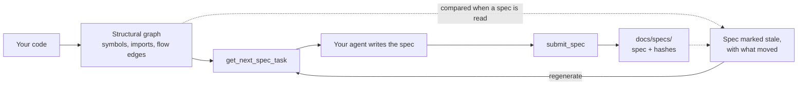

<div align="center">
<pre>
   ,___, 
   (o,o) 
   ("v") 
  ---"---
  CodeOwl
  -------
</pre>
</div>

**Docs for your codebase that tell you when they've gone out of date.**

Your own AI agent writes plain-English specs of your code. CodeOwl checks
each one against the code, so a spec that no longer matches is marked
`stale`, with what moved. Nobody has to remember to update a page, and
nobody reads a stale claim as current.

[Why CodeOwl](#why-codeowl) · [Quick start](#quick-start) ·
[How it works](#how-it-stays-honest) · [Supported stacks](#what-it-supports-today) ·
[Docs](#docs)

---

Wikis rot, and a brownfield repo often has no docs at all, so whoever needs
to know how something works rebuilds it from the code: grep, read files,
guess how things connect, and miss the edges nobody wrote down (a `fetch()`
to an API route, a `.from("table")` query).

CodeOwl's answer isn't a smarter grep. It's a **spec**: a short writeup of
what a piece of code does, in plain English. There is one per symbol, file,
directory, "feature" (a cross-cutting flow the import graph alone can't
see), and the whole system. An LLM writes each once, and CodeOwl keeps it
accurate by hashing it against the code.

Here's a real one, generated by CodeOwl about itself. Expand it to read it
(the hashes in the frontmatter are trimmed for length; `get_spec` returns
it in full):

<details>
<summary><code>docs/specs/src/hash.rs.md</code></summary>

```markdown
---
type: file
title: "src/hash.rs"
description: "Specification for `src/hash.rs`."
generated: { by: CodeOwl }
resource: "../../../src/hash.rs"
# … source_paths and the source, dependency and spec hashes, trimmed …
---
# [`src/hash.rs`](../../../src/hash.rs)
> Generated using [CodeOwl](https://github.com/siddswork/codeowl)
## Summary
Stable content hashing for every hash CodeOwl persists — `source_hash`,
`interface_hash`, `deps_hash`, `spec_hash`. One function, `hash_text`,
wrapping BLAKE3. Deliberately not `std::hash` / `DefaultHasher`, whose
output is only guaranteed stable within a single build of a single Rust
version — CodeOwl compares hashes across runs and toolchain upgrades, so
it needs a fixed algorithm that gives the same digest on any machine.

## `hash_text`
`pub fn hash_text(input: &str) -> String`
### Summary
The one hashing primitive the whole codebase uses — turns any string into
a stable lowercase-hex digest. Every `source_hash`, `interface_hash`,
`deps_hash`, and `spec_hash` is a `hash_text` of some canonical string.
### Behavior
BLAKE3 of the UTF-8 bytes, rendered as its 64-char hex string.
Deterministic and platform-independent, so a `.codeowl/` cache and a
committed spec's frontmatter compare identically across machines. No
salt, no truncation. Callers are responsible for building a canonical
input (sorted lists, fixed separators) — this function just hashes
whatever it's given.
### Depends on
- (none)
```

</details>

Edit `hash_text`, and this spec flips to `stale` the instant it's asked
for — naming exactly what moved, so nobody ever reads a stale claim as
current.

## Why CodeOwl

> [!IMPORTANT]
> CodeOwl never calls an LLM and never holds an API key. Your own agent
> writes the spec text; CodeOwl only assembles context and stores the result.

| What you get | In practice |
|---|---|
| **Staleness you can trust** | Every spec carries hashes of the code it describes and of what that code depends on. Change a signature or a dependency and the spec reads `stale`, with the cause named; change nothing that matters and it stays current. The prose is never hashed, so there is no guessing and no churn. |
| **Bring your own model** | Your agent (Claude Code, or VS Code with Copilot) writes the spec text with whatever model you already use. CodeOwl makes no model calls and adds no new place your source is sent. |
| **An open format** | Specs are [Open Knowledge Format](https://github.com/GoogleCloudPlatform/knowledge-catalog): Markdown with YAML frontmatter, linked from title to source and from each dependency to its section. Other tools can read them without CodeOwl. |
| **Sees what grep can't** | Framework conventions become real edges: a `fetch("/api/x")` reaches its route, a `.from("payments")` reaches its `CREATE TABLE`, a `<Form/>` reaches its component, and `get_callers` on a database table lists the app code that queries it. |
| **Cheap to keep current** | Write the corpus once with `--all`; after that only the specs a change invalidates are regenerated, and specs follow code you move (`adopt-moved-specs`) instead of being rewritten. |
| **Plain Markdown in git** | Specs live in `docs/specs/`, reviewed in a PR and readable by people first: a feature spec is a narrative a business analyst can follow. |

## Quick start

Needs a Rust toolchain (Linux or macOS) and Claude Code or VS Code + Copilot.

```sh
cargo build --release          # -> ./target/release/codeowl
./target/release/codeowl serve <your-repo>   # your agent's MCP config runs this
/codeowl-generate --all                      # from your agent, once, to write the corpus
```

Your agent gets ten tools: `get_symbol`, `get_source`, `get_callers`,
`get_callees`, `search_code`, `get_spec`, `get_spec_coverage`,
`explain_stale`, plus `get_next_spec_task` / `submit_spec` for generation. Full wiring:
[`setup/README.md`](setup/README.md).

A few one-off commands are for you, in a terminal, not for your agent: carrying
specs over after you move code (`adopt-moved-specs`), bringing specs from an
earlier version up to date (`migrate-file-fingerprint`, `migrate-to-okf`), and
printing the symbols CodeOwl found (`extract`). They are listed in
[`setup/USAGE.md`](setup/USAGE.md#the-command-line-what-each-command-is-for).

## How it stays honest



CodeOwl extracts a structural graph once — symbols, containment, resolved
imports, framework "flow" edges — and that graph is what makes "kept
honest" a mechanical fact instead of a promise: every spec's staleness key
is computed straight from it (a symbol's signature hash, its resolved
dependencies' interface hashes), never from the prose itself. The graph is
scaffolding, not the deliverable — it exists so spec generation is cheap,
scoped, and checkable, not the other way around.

## What to expect

- **Bootstrap once, not forever.** Spec-driven development assumes your
  code already has good specs — a brownfield repo doesn't. Run `--all`
  once to write the whole corpus; after that, a change only regenerates
  the specs it actually invalidates, never the whole repo. Ongoing cost is
  upkeep, not a recurring LLM tax.
- **Written for people.** A feature spec is a numbered, BA-followable
  narrative of a capability end to end; file and symbol specs give a
  developer the exact files, dependencies, and tables involved. A coding
  agent can read the same documents over MCP, but whether that helps it
  is unmeasured, and CodeOwl makes no claim that it does.
- **Upgrading.** Specs written by an earlier version are brought up to date
  by one command, `codeowl migrate-to-okf`; see
  [Upgrading from an earlier version](setup/USAGE.md#upgrading-from-an-earlier-version).

## What it supports today

Written in **Rust**; ships as a single self-contained binary that runs as
an MCP server (`codeowl serve <repo>`). CodeOwl picks one *stack* per repo
automatically. TypeScript, SQL, Rust, Java and Python are supported.

<details>
<summary>What each stack extracts</summary>

| Stack | What it extracts |
|---|---|
| **TypeScript / TSX** | functions, classes, methods, consts; `import`/re-export resolution via `oxc_resolver`; Next.js App Router features (`app/**/page.tsx`, orphan API routes); `fetch("/api/…")` → route, Supabase `.from("table")` → schema, React `<Component/>` → file flow edges |
| **SQL schema** | `CREATE TABLE` → table nodes with column lists, resolved against the app code that queries them |
| **Rust** | `fn` / `struct` / `enum` / `trait` / `impl` / `mod` / `const` / `macro_rules!`; `use crate::…` / `super::` / `pub use` module-tree resolution, per crate in a workspace, plus `use`s of a library crate by name (workspace siblings, or a package's own library from its binary and tests) read from `Cargo.toml`; `///` + `//!` docs; `#[derive(…)]` / attribute markers. No feature layer — a library or CLI has no routes to enumerate. |
| **Java** | `class` / `interface` / `enum` / `record` / `@interface` → containers, with their methods, constructors, and fields; Javadoc docstrings; `@Annotation` markers; `import a.b.C` resolved by path-suffix match (Maven, Gradle, or bare layout) plus same-package implicit references. No feature layer for a plain library; a **Quarkus** feature model when the service conventions are there — heterogeneous entry-point kinds coexisting in one service (JAX-RS `@Path` + verb, Kafka `@Incoming`/`@Outgoing`, `@Scheduled`, `@GrpcService`), CDI-shaped core admission, a JPA/Panache schema idiom, and cross-service flow edges carried by string (`@RegisterRestClient`). |
| **Python** | `class` / `def` / module-level assignments; decorators captured verbatim (with arguments) as markers; `"""docstrings"""`; dotted-module and relative `import` resolution; a symbol-level schema seam (SQLModel / SQLAlchemy `table=True` → schema nodes); a **FastAPI** feature model (route enumeration, `APIRouter` prefix threading, `Depends()` → flow edges). No feature layer for a plain library. |

</details>

Next up: verifying build-generated-interface entry points under Gradle
(Maven is confirmed), then a polyglot mode — one primary stack plus
secondary-language subtrees in the same repo. See `ROADMAP.md`.

## Docs

- **What & why:** [`REQUIREMENTS.md`](REQUIREMENTS.md)
- **How it's built:** [`ARCHITECTURE.md`](ARCHITECTURE.md)
- **Why, and what's undecided:** [`DECISIONS.md`](DECISIONS.md)
- **Vocabulary:** [`GLOSSARY.md`](GLOSSARY.md)
- **Build sequence:** [`ROADMAP.md`](ROADMAP.md)
- **How it compares, and the KPIs we track:** [`NORTHSTAR.md`](NORTHSTAR.md)
- **Wire it into your own repo:** [`setup/README.md`](setup/README.md)
- **Use it day to day:** [`setup/USAGE.md`](setup/USAGE.md)
- **Already have specs from an earlier version?**
  [Upgrading from an earlier version](setup/USAGE.md#upgrading-from-an-earlier-version)

## License

MIT — see [`LICENSE`](LICENSE).
